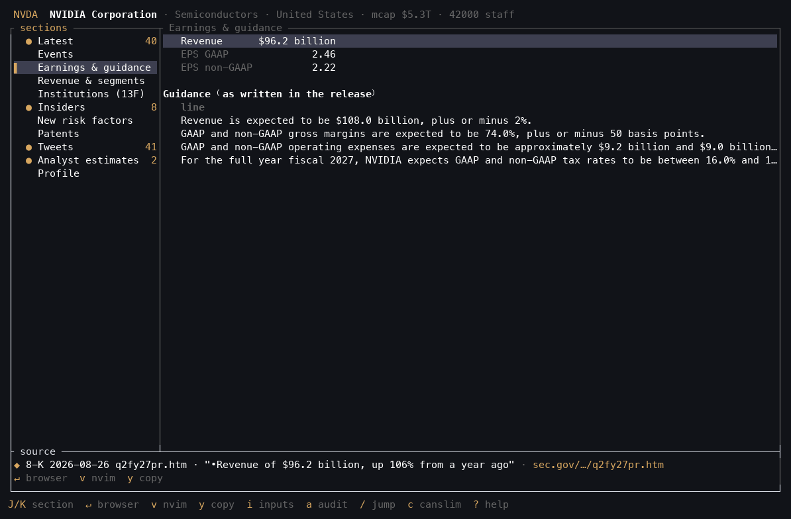
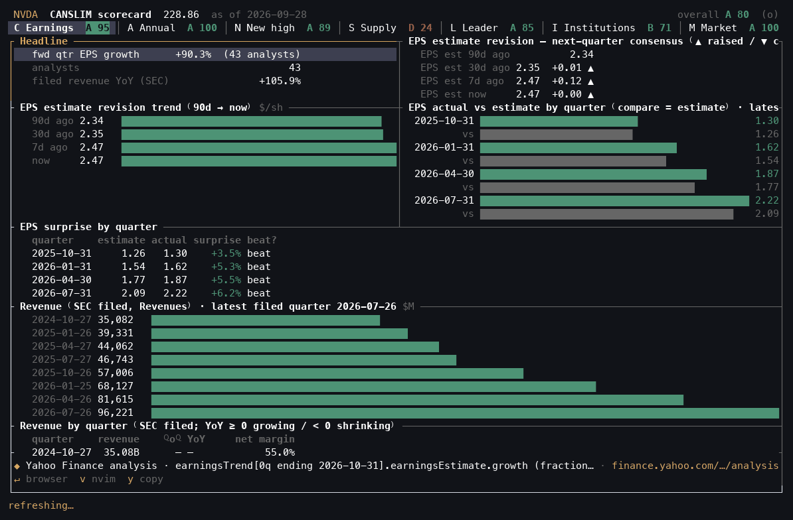
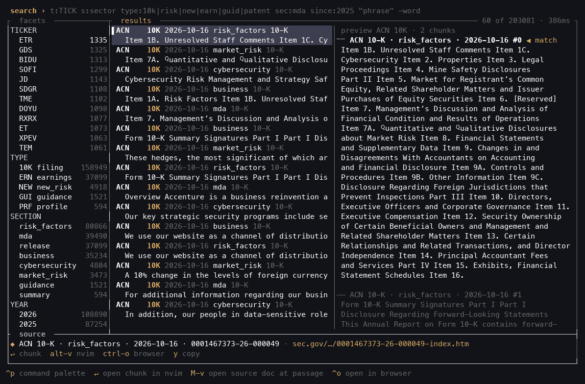
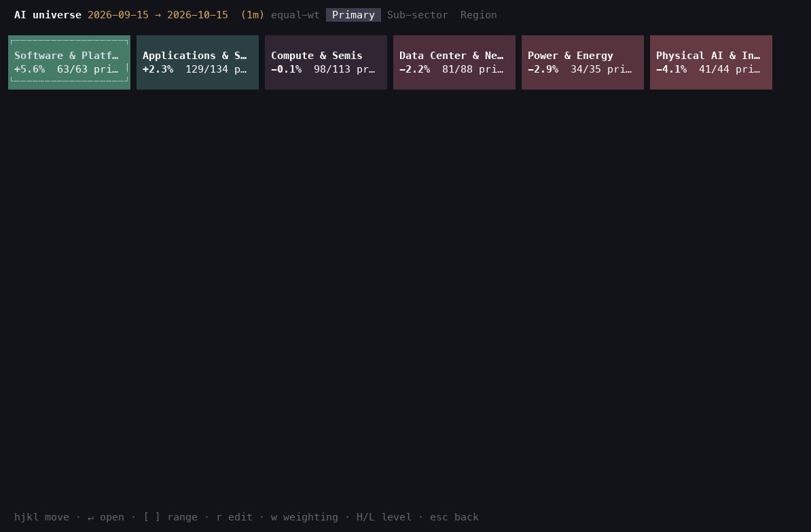
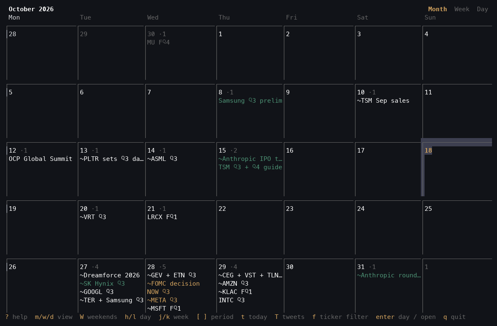
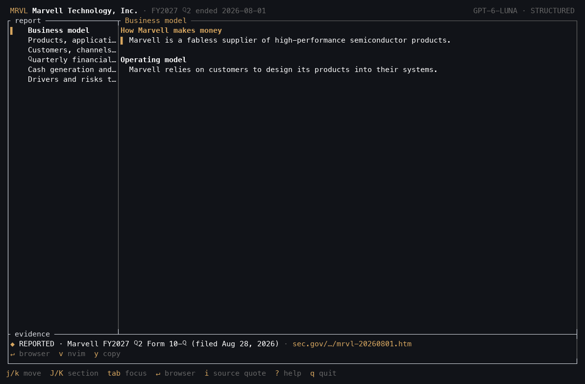
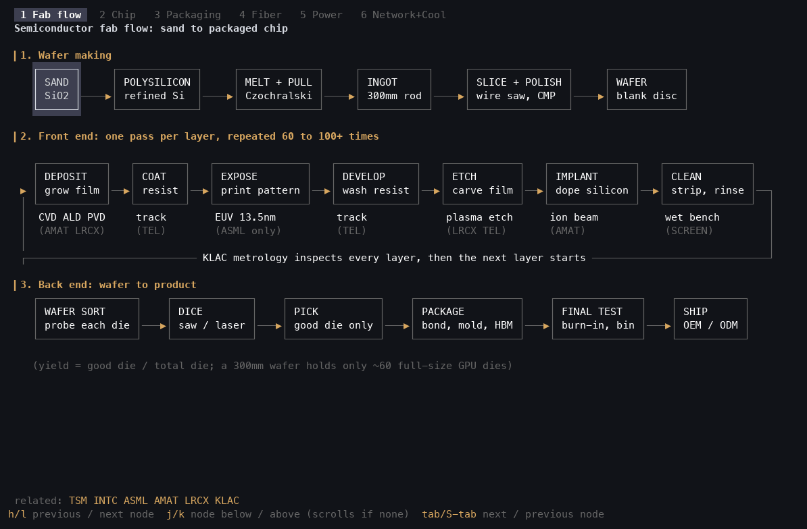

# finlarp

Terminal-native equity research desk. SEC EDGAR filings, 13F holdings, insider trades, earnings and
tweets land in a local DuckDB file; a Rust/ratatui UI and a Neovim plugin read it, and an MCP server
gives agents the same data.



## The rule

Every number on screen carries its source: a link to the filing that
reported it (opening at the quoted text), or the formula and inputs it was
computed from. Press `i` on any value to see where it came from. A value
without a source is treated as a bug. See [`tui/ARCHITECTURE.md`](tui/ARCHITECTURE.md).

## Screens

| Screen | What it shows |
|---|---|
| `dossier` | One-ticker briefing: revenue and segments, guidance, 13F flows, insider trades, new risk factors |
| `canslim` | CANSLIM scorecard, each letter graded with its evidence |
| `search` | Full-text search over 10-K/20-F text, earnings releases, guidance and patents |
| `chart` | Price history |
| `portfolio` | Your account: equity vs benchmark, drawdown, positions (E*TRADE; some tabs are placeholders) |
| `earnings` | Structured earnings report (proof of concept, MRVL only) |
| `events` | AI-stock catalyst calendar (month / week / day). `T` adds the tweets that name a ticker, `f` filters them by ticker, Enter on a tweet opens it |
| `universe` | AI universe heatmap: sectors and regions, weighted by price move over a chosen window |
| `diagrams` | Animated process diagrams (chip fab flow, fiber optics, data center power) with a page per node |

### More screens

| | |
|---|---|
|  |  |
|  |  |
|  |  |

<details>
<summary>All diagram tabs</summary>

| | |
|---|---|
|  |  |
|  |  |
|  | |

</details>

These are recorded from the real binary by `just gifs` (see [Development](#development)). Not recorded:
`portfolio`, `chat` and `notes` (personal data), and `chart` / `candles` (portfolio history and mock bars).

## Layout

```
tui/                 Rust: terminal UI (ratatui); reads the DuckDB file
docs/screens/        GIFs of the screens above, written by py/jobs/record_screens.py
lua/finlarp/         Lua: Neovim plugin (launches the TUI, treemap dashboards, pickers, document viewer)
py/                  Python: everything that fetches or computes data
  core/                DuckDB cache (db.py) and pydantic schemas
  sources/             data pullers, one module per dataset
  derive/              derived data: search index, CANSLIM scores, dossiers, account tables (fills, round trips, equity)
  jobs/                batch scripts
  agent/               read-only MCP server over the same data
data/                universe lists (local, gitignored)
```

## Requirements

- [uv](https://docs.astral.sh/uv/) and Python 3.12+
- Rust toolchain
- Neovim 0.10+, for the plugin
- tmux (optional; the TUI opens in a tmux popup, otherwise a floating terminal)
- E*TRADE API keys, only for the portfolio screen

## Setup

```sh
git clone https://github.com/JacksonFaulkner/finlarp
cd finlarp
cp .env.example .env    # fill in the keys you need
just setup              # uv sync + cargo build --release
```

Neovim, with lazy.nvim:

```lua
{
  "JacksonFaulkner/finlarp",
  keys = {
    { "$", function() require("finlarp").show() end, desc = "finlarp: portfolio treemap" },
    { "<leader>vww", function() require("finlarp").pick() end, desc = "finlarp: pick watchlist (fullscreen)" },
    { "<leader>vwl", function() require("finlarp").pick("left") end, desc = "finlarp: pick watchlist (left half)" },
    { "<leader>vwr", function() require("finlarp").pick("right") end, desc = "finlarp: pick watchlist (right half)" },
    { "<leader>vu", function() require("finlarp").pick_universe() end, desc = "finlarp: AI universe layer/sub-sector/region picker" },
    { "<leader>vf", function() require("finlarp").pick_search() end, desc = "finlarp: search SEC filings / earnings text" },
    { "<leader>vo", function() require("finlarp").switch() end, desc = "finlarp: switch open dashboards" },
    { "<leader>vc", function() require("finlarp").show_chart_current() end, desc = "finlarp: chart selected/focused symbol" },
    { "<leader>vt", function() require("finlarp").pick_transactions() end, desc = "finlarp: search transaction history" },
    { "<leader>vh", function() require("finlarp").show_portfolio_history() end, desc = "finlarp: daily % change history chart" },
    { "<leader>vp", function() require("finlarp").show_portfolio_suite() end, desc = "finlarp: portfolio suite" },
    { "<leader>vD", function() require("finlarp").show_diagrams() end, desc = "finlarp: diagrams" },
    { "<leader>ve", function() require("finlarp").show_events() end, desc = "finlarp: catalyst calendar" },
    { "<leader>vC", function() require("finlarp").pick_canslim() end, desc = "finlarp: CANSLIM scorecard picker" },
  },
}
```

The binary also runs on its own:

```sh
tui/target/release/finlarp "" "" "" dossier MRVL
```

Press `?` on any screen for its keys.

## Pulling data

Each puller in `py/sources/` runs on its own; its module docstring describes
what it fetches. SEC allows 10 requests per second per client; each process
defaults to 1.5 (`SEC_RPS` overrides it).

```sh
uv run python py/sources/bulk_pull.py              # large bulk files (patents, SEC data sets)
uv run python py/sources/sec_filing_text.py ingest
uv run python py/sources/sec_filing_text.py build
uv run python py/derive/dossier.py --all
```

### Scheduled refresh

`py/jobs/refresh.py` runs the pullers on a schedule (module docstring has the details):

- **daily** (weekdays 18:30): every SEC puller in one lane (8-Ks, new 10-K/10-Q
  XBRL, earnings, segments, filing text, insiders, 13F, FSDS), Databento bars
  (only the days since the last pull, capped at $15), Yahoo profiles, new tweets
  then sentiment, ROIC news for the universe, arXiv; then the search index and
  every dossier.
- **intraday** (every 30 min, weekdays 08:00-17:00 ET): new tweets then
  sentiment, plus news and 8-Ks for the watchlist (E*TRADE positions plus
  `data/watchlist.txt`).

```sh
just refresh daily --dry-run      # the plan; steps whose API key is unset are skipped
just refresh intraday --force     # one run now, outside market hours
just schedule                     # install the launchd agents (just unschedule removes them)
```

Logs: `~/.local/share/nvim/finlarp/logs/<mode>/`; reports: `.../debug/refresh_*.json`.
Patents (`bulk_pull.py pv`, then `patents.py`) and `jobs/pull_following.py` change
rarely and stay manual.

## MCP server

`py/agent/server.py` gives an agent read access to the same data over stdio:
full-text search, company briefings, financial time series and read-only SQL, plus tweet sentiment
(`sentiment`, `sentiment_leaders`, `price_targets`) and company news (`news`).

```sh
claude mcp add finlarp -- "$PWD/.venv/bin/python" -m agent.server
```

Remote access over streamable HTTP, every request must send `Authorization: Bearer $FINLARP_MCP_TOKEN`
(refuses to start if the token is under 32 characters):

```sh
FINLARP_MCP_TOKEN=$(python3 -c 'import secrets; print(secrets.token_urlsafe(32))') \
  .venv/bin/python -m agent.server --http    # http://127.0.0.1:8765/mcp
```

Set `FINLARP_MCP_HOST` / `FINLARP_MCP_PORT` to change the bind address. Put TLS in front of it before
exposing it beyond localhost.

## Development

```sh
just check   # stylua, selene, ruff, clippy, cargo test
just hooks   # install pre-commit hooks
just gifs    # re-record docs/screens/*.gif (needs tmux and a release build; `just gifs --only dossier` for one)
```

## License

MIT. Personal project shared as-is: expect rough edges and assumptions about my setup. Nothing here is investment advice.
