# finlarp

Terminal-native equity research desk. SEC EDGAR filings, 13F holdings, insider trades, earnings and
tweets land in a local DuckDB file; a Rust/ratatui terminal UI (`fl`) reads it, and an MCP server
gives agents the same data.

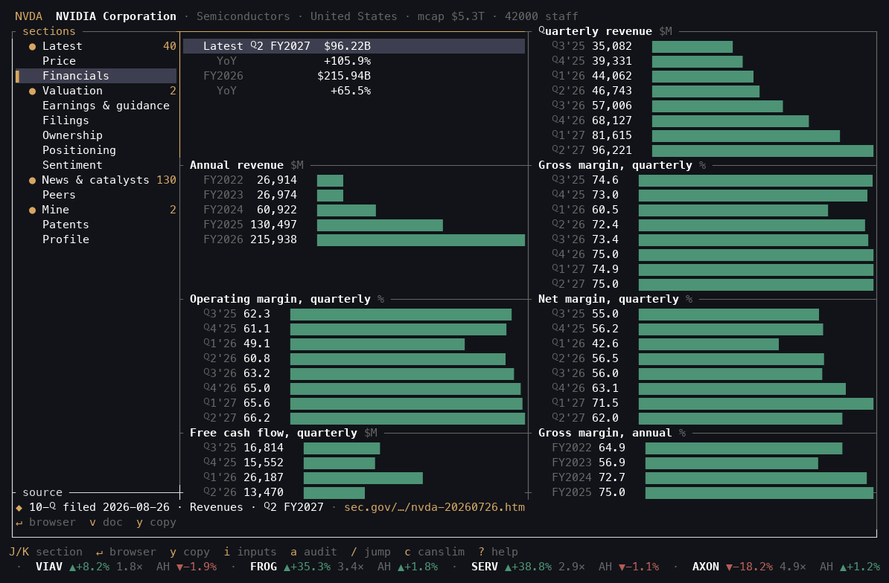

## The rule

Every number on screen carries its source: a link to the filing that
reported it (opening at the quoted text), or the formula and inputs it was
computed from. Press `i` on any value to see where it came from. A value
without a source is treated as a bug. See [`tui/ARCHITECTURE.md`](tui/ARCHITECTURE.md).

## Screens

| Screen | What it shows |
|---|---|
| `home` | The launcher: the keyboard is the menu, and each key opens its screen |
| `dossier` | One-ticker briefing: revenue and segments, guidance, 13F flows, insider trades, new risk factors |
| `canslim` | CANSLIM scorecard, each letter graded with its evidence |
| `search` | Full-text search over 10-K/20-F text, earnings releases, guidance and patents |
| `filings` | EDGAR 8-K / 6-K index, filtered with `t:`, `item:` and `form:`. Enter opens the filing in the browser |
| `earnings` | Structured earnings report (proof of concept, MRVL only) |
| `events` | AI-stock catalyst calendar (month / week / day). `T` adds the tweets that name a ticker, `f` filters them by ticker, Enter on a tweet opens it |
| `universe` | AI universe heatmap: sectors, sub-sectors, regions and funds, tiles coloured by price move over a chosen window. `p` switches to a pie |
| `diagrams` | Animated process diagrams: chip fab flow, memory, packaging, fiber, power, network and cooling. A page per node, zoom-ins per page, and a 3D bell jar in the polysilicon zoom |
| `sources` | The providers and datasets behind the screens. Enter searches a dataset |
| `portfolio` | Your account: equity vs benchmark, drawdown, positions, daily % change history (E*TRADE; some tabs are placeholders) |
| `chart` | Daily portfolio value over time, from the E*TRADE snapshots |

Screens that show your account, watchlists, notes or a live feed (`portfolio`, `chart`, `transactions`,
`intraday`, `watchlists`, `notes`, `chat`, `godel`) are not in the gallery below.

### More screens

| | |
|---|---|
| 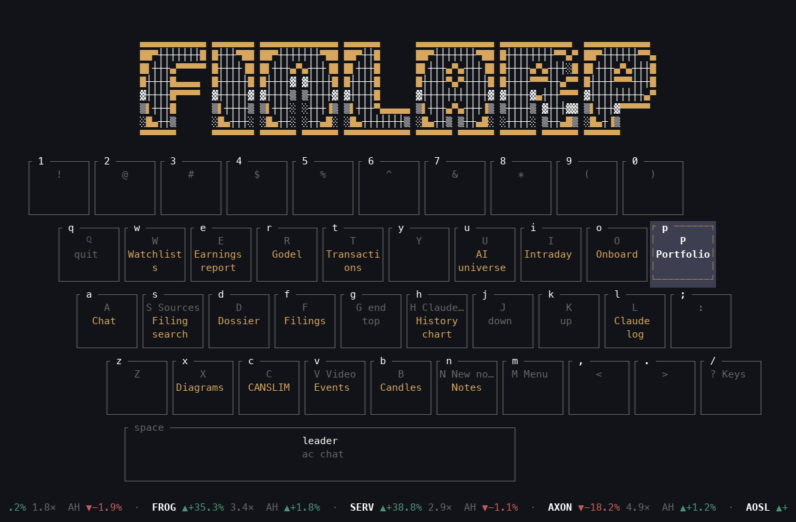 | 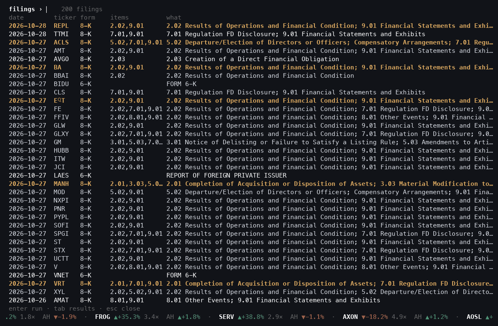 |
| 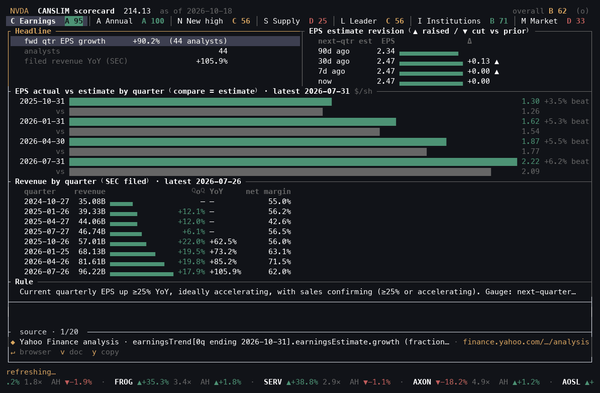 | 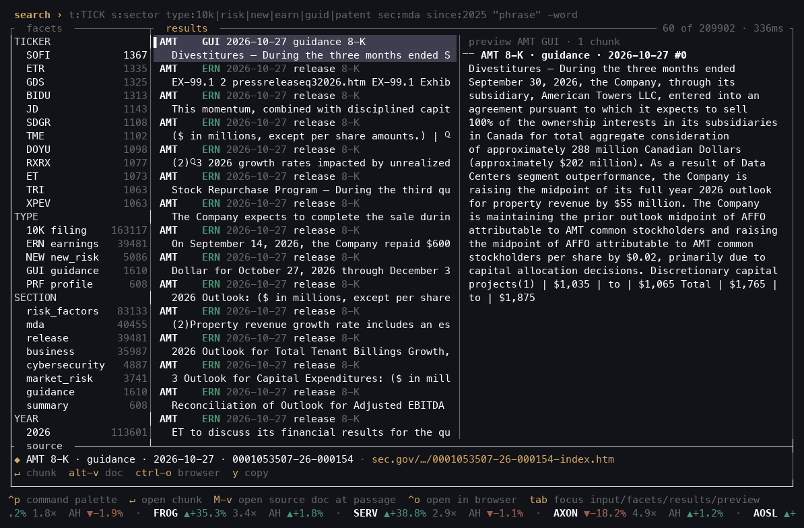 |
| 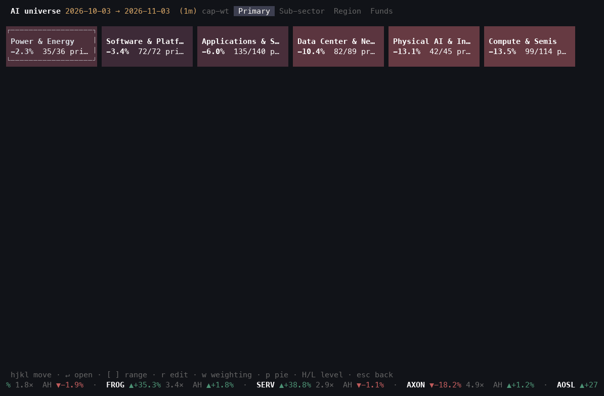 | 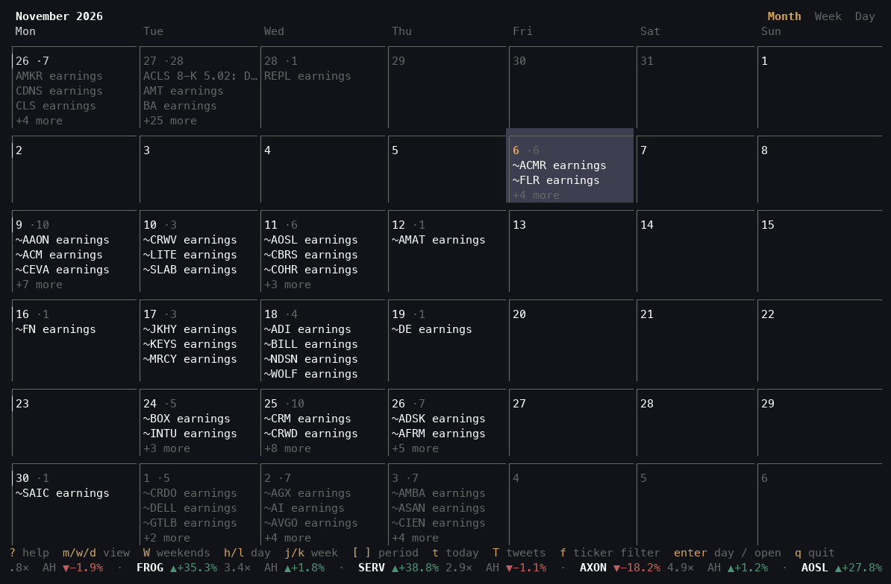 |
| 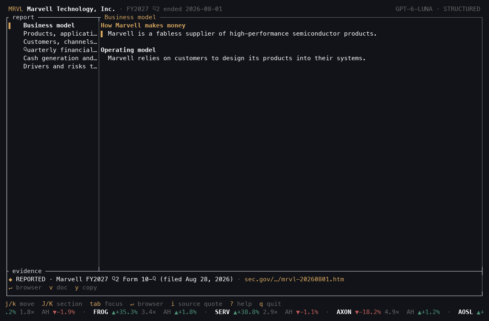 | 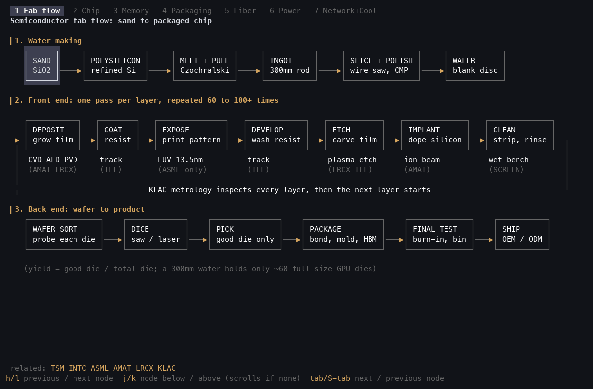 |

The Siemens bell jar from the polysilicon diagram (zoom `c`), in 3D:

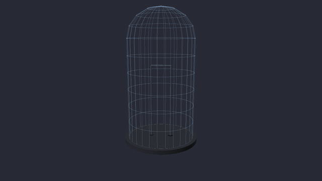

<details>
<summary>All diagram tabs</summary>

| | |
|---|---|
| 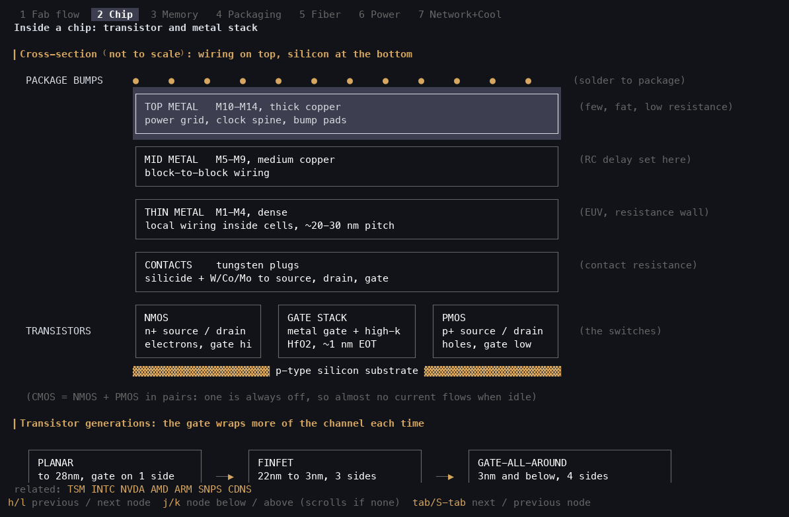 | 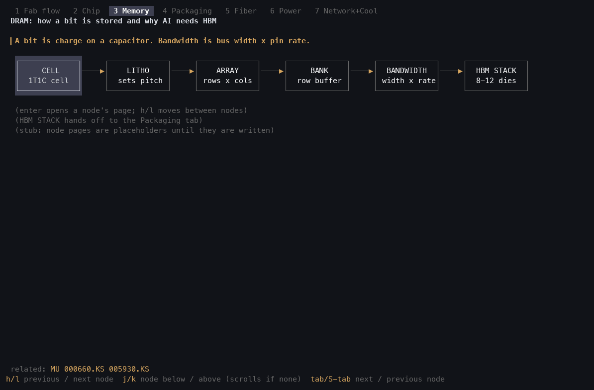 |
| 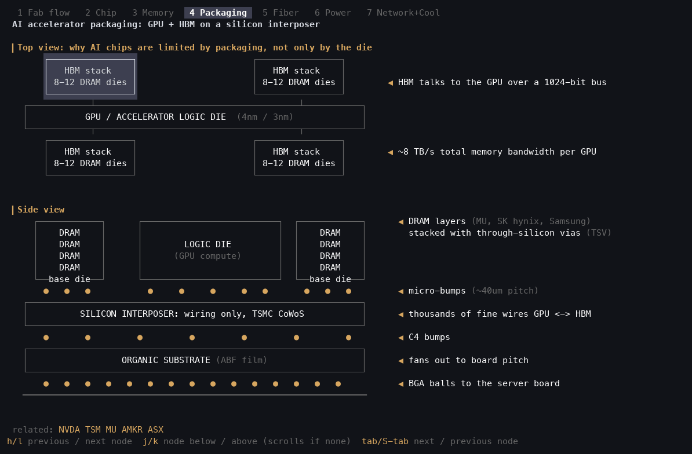 | 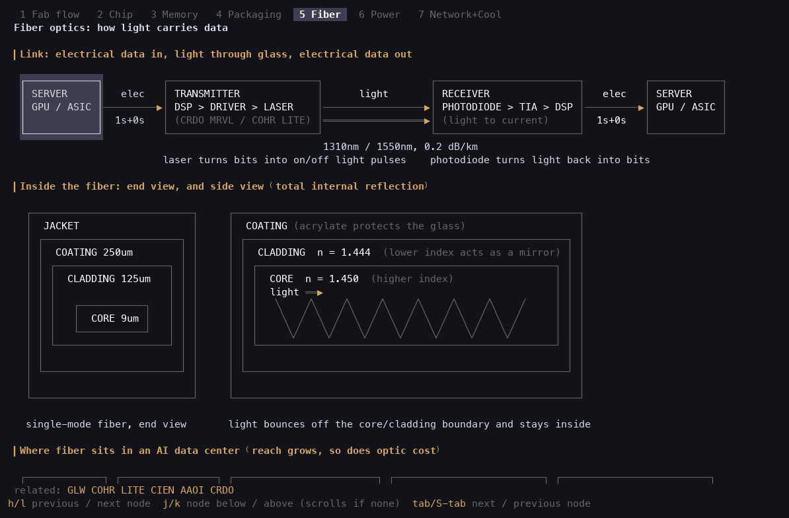 |
| 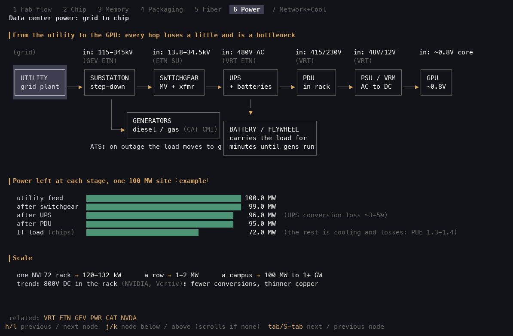 | 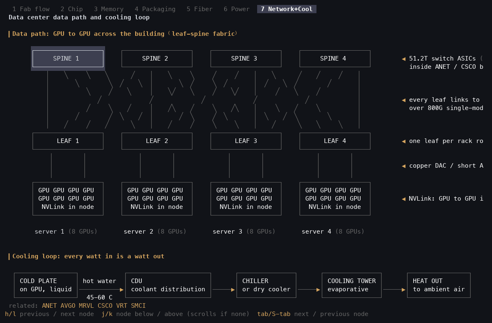 |

</details>

These are recorded from the real binary by `just gifs` (see [Development](#development)). The bell jar is the
exception: tmux cannot capture the 3D view, so `tools/poly3d` renders that clip offline with the same rasterizer.

## Layout

```
tui/                 Rust: terminal UI (ratatui); reads the DuckDB file
tools/poly3d/        Rust: 3D bell-jar rasterizer (shared with the TUI) and the offline clip for the docs
docs/screens/        GIFs of the screens above: py/jobs/record_screens.py, plus tools/poly3d for the bell jar
py/                  Python: everything that fetches or computes data
  core/                DuckDB cache (db.py) and pydantic schemas
  sources/             data pullers, one module per dataset
  derive/              derived data: search index, CANSLIM scores, dossiers, account tables (fills, round trips, equity)
  jobs/                batch scripts
  agent/               read-only MCP server over the same data
video/               Remotion promo cut from the docs/screens GIFs
data/                universe lists (local, gitignored)
```

## Requirements

- [uv](https://docs.astral.sh/uv/) and Python 3.12+
- Rust toolchain
- tmux (optional; needed for `just claude`, `just gifs`, and the Claude popup inside `fl`)
- ffmpeg (optional; only for `tools/poly3d/run.sh`)
- E*TRADE API keys, only for the portfolio screen

## Setup

```sh
git clone https://github.com/JacksonFaulkner/finlarp
cd finlarp
cp .env.example .env    # fill in the keys you need
just setup              # uv sync + cargo build --release
```

## Running

`just install` symlinks the release build to `~/.local/bin/fl`, so `fl` runs from any terminal.
`just build` makes the binary without installing it, at `tui/target/release/fl`.

```sh
fl                        # home menu
fl dossier MRVL           # open a screen directly
fl search t:MRVL guidance # the rest of the line is the screen argument
fl video                  # play the recordings in docs/screens inside the terminal
```

Press `?` on any screen for its keys.

## Data

- **Data dir:** `<repo>/data/`. `FINLARP_DATA` moves the whole dir for both `fl` and the Python
  scripts. The DuckDB file is `data/finlarp.duckdb`; `FINLARP_DB` points `fl` at another file.
- **Universe and alias inputs:** `data/` in the repo (`ai_stocks_reviewed.json`, `cik_aliases.json`,
  `patent_aliases.json`); gitignored.
- **Pull caches:** `<repo>/data/<source>/`, one directory per puller.

## Pulling data

Each puller in `py/sources/` runs on its own; its module docstring describes
what it fetches. SEC allows 10 requests per second per client; each process
defaults to 1.5 (`SEC_RPS` overrides it). Run the scripts from the repo root with
`uv run`; `uv run --env-file .env` loads the API keys from `.env` (`just refresh` does this).

```sh
uv run python py/sources/bulk_pull.py              # large bulk files (patents, SEC data sets)
uv run python py/sources/sec_filing_text.py ingest
uv run python py/sources/sec_filing_text.py build
uv run python py/derive/dossier.py --all
```

### Scheduled refresh

`py/jobs/refresh.py` runs the pullers on a schedule (module docstring has the details):

- **daily** (weekdays 18:30): every SEC puller in one lane (8-Ks, new 10-K/10-Q
  XBRL, earnings, segments, filing text, insiders, 13F, FSDS), Databento bars
  (only the days since the last pull, capped at $15), Yahoo profiles, new tweets
  then sentiment, arXiv; then the search index and
  every dossier.
- **intraday** (every 30 min, weekdays 08:00-17:00 ET): new tweets then
  sentiment, plus 8-Ks for the watchlist (E*TRADE positions plus
  `data/watchlist.txt`).

```sh
just refresh daily --dry-run      # the plan; steps whose API key is unset are skipped
just refresh intraday --force     # one run now, outside market hours
just schedule                     # install the launchd agents (just unschedule removes them)
```

Patents (`bulk_pull.py pv`, then `patents.py`) and `jobs/pull_following.py` change
rarely and stay manual.

## MCP server

`py/agent/server.py` gives an agent read access to the same data over stdio:
full-text search, company briefings, financial time series and read-only SQL, plus tweet sentiment
(`sentiment`, `sentiment_leaders`, `price_targets`). Latest headlines come from Yahoo (`live_news`).

```sh
claude mcp add finlarp -- "$PWD/.venv/bin/python" -m agent.server
```

Remote access over streamable HTTP, every request must send `Authorization: Bearer $FINLARP_MCP_TOKEN`
(refuses to start if the token is under 32 characters):

```sh
FINLARP_MCP_TOKEN=$(python3 -c 'import secrets; print(secrets.token_urlsafe(32))') \
  .venv/bin/python -m agent.server --http    # http://127.0.0.1:8765/mcp
```

Set `FINLARP_MCP_HOST` / `FINLARP_MCP_PORT` to change the bind address. Put TLS in front of it before
exposing it beyond localhost.

## Development

```sh
just check   # stylua, selene, ruff, clippy, cargo test
just hooks   # install pre-commit hooks
just gifs    # re-record docs/screens/*.gif (needs tmux and a release build; `just gifs --only dossier` for one)
tools/poly3d/run.sh   # re-render the bell-jar clip into docs/screens/diagrams_bell_jar.gif (needs ffmpeg)
```

## License

MIT. Personal project shared as-is: expect rough edges and assumptions about my setup. Nothing here is investment advice.
